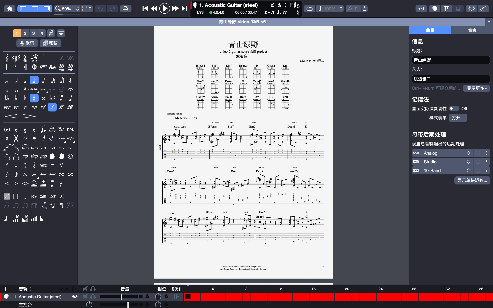

# Video to Guitar Score

[简体中文](README.zh-CN.md) · English

An AI-agent skill for recovering guitar TAB or notation visibly shown in an authorized video and producing a reviewable, editable Guitar Pro score package.

It treats the displayed TAB pixels as the authority for string and fret choices, keeps per-event visual provenance, and uses full-score validation before a file can be called final.

## Contents

- `SKILL.md` — workflow, quality gates, and output contract
- `references/` — transcription ledger schema and review-mode requirements
- `scripts/` — extraction, OCR assistance, validation, MIDI/MusicXML, and Guitar Pro 5 utilities

## Scope

Use this only for videos that visibly display notation or TAB and that you are authorized to process. It is not an audio-only transcription tool.

## How to use it

Give an AI agent an authorized video link or local video file, and ask it to extract the **notation visibly shown in the video** into a playable Guitar Pro score. For example:

> Please extract the guitar TAB visibly displayed in this authorized video and create a validated, playable Guitar Pro score (`.gp` or `.gp5`): https://www.bilibili.com/video/BV1vyLR6REJU

The agent should keep the video TAB as the source of truth for string/fret choices, review any ambiguous measures with you, and deliver an editable Guitar Pro file. When the video contains clear, complete notation, the result can be opened and played back in Guitar Pro, with rendered PDF/image pages and optional MIDI or MusicXML exports.



### What to provide

- An authorized local video or a link that the agent is permitted to process.
- A video in which the notation or TAB is sufficiently legible on screen.
- Your preferred review mode: `standard` (default) or `strict` (you approve every measure).

This skill reads existing, displayed notation; it does not invent a TAB from performance audio or hand movements alone.

## Install

Install or import this directory using your AI tool's skill, agent, or prompt-extension workflow. Then invoke it for an authorized video with legible displayed guitar notation.

### Cross-platform runtime

The main workflow supports macOS, Windows, and Linux. Install Python 3.10+ and the Python packages below:

```bash
python -m pip install -r requirements.txt
```

Install **FFmpeg** for video-frame extraction and **Tesseract OCR** for the portable TAB-digit candidate workflow. The agent can run `scripts/recognize_tab_fingering.py` on any supported system; it produces candidates only, so every string/fret value still needs visual verification against the displayed TAB.

On macOS, `scripts/vision_ocr.swift` and `scripts/vision_ocr.m` are optional Apple Vision OCR accelerators. They are not required and are never the only route through the skill. Their JSON output is compatible with the portable `scripts/map_tab_ocr.py` mapping step.

## License

Released under the [MIT License](LICENSE).
