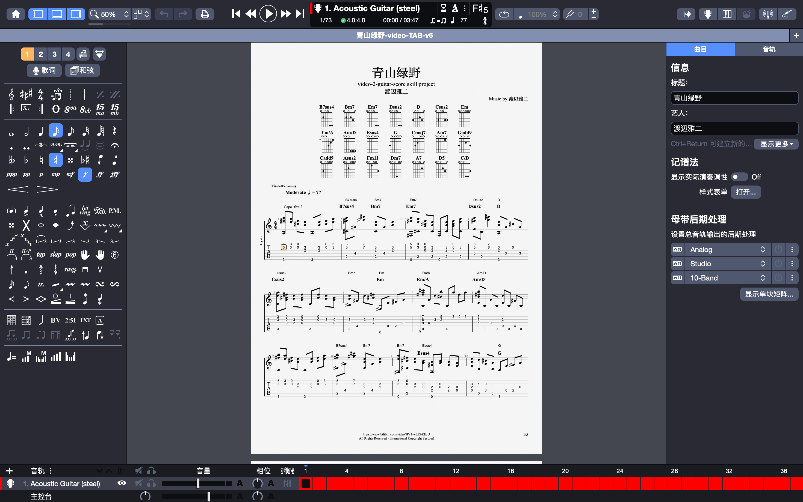

# 视频转吉他谱

[English](README.md) · 简体中文

这是一个面向 AI Agent 的 Skill：从**获授权视频中清晰显示的吉他 TAB 或五线谱**提取乐谱，生成可审阅、可编辑、可播放的 Guitar Pro 乐谱包。

它以视频画面中的 TAB 为唯一指法依据：保留原谱的弦号与品位，而不是根据音高重新猜测一个“看起来合理”的指法。每个音符都保留画面出处，完成前还会进行全曲验证。

## 能做什么

- 从教学、演奏视频中提取画面里显示的吉他 TAB / 五线谱。
- 生成可在 Guitar Pro 中打开、编辑和播放的 `.gp` 或 `.gp5` 文件。
- 输出新排版的 PDF / 图片乐谱，并可选导出 MIDI 和 MusicXML。
- 保留弦号、品位、节奏、和弦、调弦、变调夹与有明确画面证据的演奏技巧。
- 为每个小节和音符记录来源画面、时间戳与区域，便于复核。

## 适用范围

仅用于处理你有权访问和处理、且**画面中实际显示了清晰乐谱或 TAB**的视频。

它不是“只听音频自动扒谱”工具，也不会仅根据演奏动作或和弦名称杜撰 TAB。视频画面无法辨认的内容会被标记为待确认，不能作为最终谱面的确定内容。

## 如何使用

把本目录按你所用 AI 工具的 Skill、Agent 或提示词扩展方式导入，然后给 Agent 一个获授权的视频链接或本地视频文件，并说明你想要的结果。

可以直接复制下面这段指令：

> 请从这个获授权视频中提取画面显示的吉他 TAB，生成经过验证、可在 Guitar Pro 中播放的乐谱文件（`.gp` 或 `.gp5`）：https://www.bilibili.com/video/BV1vyLR6REJU

Agent 应当：

1. 以画面中的 TAB 为准，保留原有弦位与品位；
2. 标记看不清、低置信度或有冲突的小节，并请你确认；
3. 输出可编辑、可播放的 Guitar Pro 文件；
4. 视需要额外输出 PDF、图片、MIDI、MusicXML 及验证报告。

当视频中的谱面完整、清晰时，生成的文件可以直接在 Guitar Pro 中打开和播放。



### 你需要提供什么

- 获授权的本地视频，或允许 Agent 处理的视频链接；
- 画面中足够清晰、完整的 TAB 或五线谱；
- 审阅模式：`standard`（默认，仅确认存在疑问的小节）或 `strict`（逐小节确认）。

## 项目结构

- `SKILL.md`：完整工作流、质量门槛和输出约定。
- `references/`：转录账本格式与审阅模式说明。
- `scripts/`：视频取帧、OCR 辅助、验证、MIDI / MusicXML 与 Guitar Pro 5 工具。
- `assets/`：README 中使用的示例素材。

## 跨平台运行

主流程支持 macOS、Windows 和 Linux。安装 Python 3.10+ 后，运行：

```bash
python -m pip install -r requirements.txt
```

还需要安装：

- **FFmpeg**：提取视频帧；
- **Tesseract OCR**：跨平台识别 TAB 中的品位数字。

通用 OCR 路径使用 `scripts/recognize_tab_fingering.py`，可在三个系统上运行。OCR 只生成候选结果；每个弦号与品位仍必须回到视频中的 TAB 画面进行视觉确认。

macOS 用户可选择 `scripts/vision_ocr.swift` 或 `scripts/vision_ocr.m`，利用 Apple Vision 获得可选的 OCR 加速。这不是必需条件，不会影响 Windows 或 Linux 使用者；其输出可交给通用的 `scripts/map_tab_ocr.py` 继续处理。

## 许可证

本项目采用 [MIT License](LICENSE)。你可以使用、修改、分发和用于商业项目，但应保留版权声明与许可证文本。
